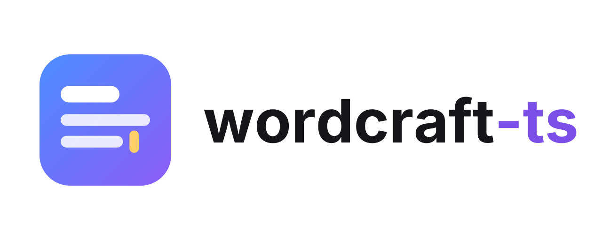
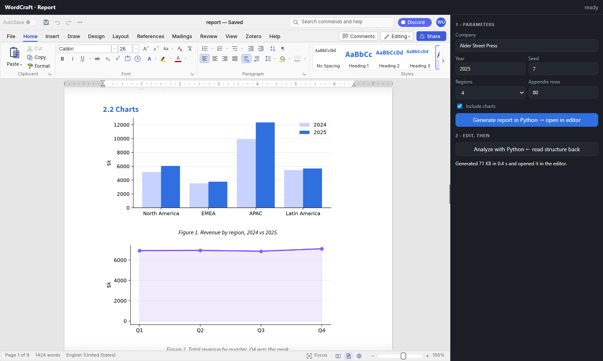
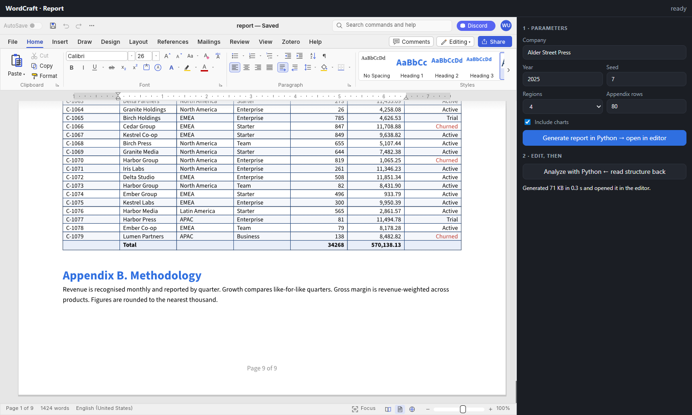

<p align="center">
  <picture>
    <source media="(prefers-color-scheme: dark)" srcset="logos/export/logo-dark.svg">
    
  </picture>
</p>

<p align="center"><b>A full Word-style editor you can drop into any website, from TypeScript.</b></p>

[WordCraft](https://github.com/storytold/wordcraft) is an open-source word processor written in Rust. This
package compiles it to WebAssembly and wraps it in a small typed API: open `.docx`, edit with the ribbon,
styles, tables and track changes, then export `.docx`, `.odt`, `.rtf`, `.html`, `.md` or `.txt`. The editor runs
entirely in the browser; it sends nothing anywhere unless your code does (see the automation examples).


> Not published to npm yet. Build it from this repo (see [Build from source](#build-from-source)) and link it, as the
> examples do.

## Use it

```ts
import { mountEditor } from "wordcraft-ts";

const editor = await mountEditor(document.querySelector("canvas")!, { sample: false });

await editor.load(file);                  // File | Blob | Uint8Array (docx, odt, rtf, md, txt, html)
const blob = await editor.exportBlob();   // .docx; or "odt" | "rtf" | "html" | "md" | "txt"
const off = editor.onDirty((dirty) => console.log("unsaved changes:", dirty));

editor.destroy();                         // stop the editor and free its canvas
```

| API | What it does |
|---|---|
| `mountEditor(canvas, opts?)` | Starts an editor on a `<canvas>`. Options: `sample` (open the demo document), `webgl` (force WebGL2), `wasmUrl` (where to load the `.wasm` from). |
| `editor.load(file, name?)` | Opens a document. The format comes from the file name's extension. |
| `editor.export(format?)` / `exportBlob(format?)` | Returns the document as bytes / a `Blob`. Default `docx`. |
| `editor.onDirty(cb)` | Called when the unsaved-changes flag flips. Returns an unsubscribe function. |
| `editor.destroy()` | Stops this editor. Unsaved changes are lost. |

Any number of editors can share a page, one per canvas. Give each canvas a size with CSS; it resizes itself.

## Examples

### Run an example

One-time setup from the repo root builds the package and links it so the examples can import it:

```sh
bun install
bun run build     # Rust -> wasm -> dist (needs the toolchain in "Build from source")
bun link
```

Then, for any example:

```sh
cd examples/react      # any folder from the tables below
bun install
bun run dev
```

### Framework examples

Each is a small page with Open, an export-format picker, Export and an unsaved-changes indicator.

| Framework | Folder |
|---|---|
| Next.js (multi-document workspace) | [`examples/nextjs`](examples/nextjs) |
| React + Vite | [`examples/react`](examples/react) |
| Vue 3 + Vite | [`examples/vue`](examples/vue) |
| Svelte 5 + Vite | [`examples/svelte`](examples/svelte) |
| Astro (plain script, no UI framework) | [`examples/astro`](examples/astro) |

On Vite and Astro, add `optimizeDeps: { exclude: ["wordcraft-ts"] }` to the config (every example does), so the
`.wasm` URL inside the package keeps resolving. On Next.js, add `transpilePackages: ["wordcraft-ts"]`.

#### Next.js: multiple documents

[`examples/nextjs`](examples/nextjs) is a multi-document workspace: a sidebar and tab bar, one editor per
document, New / Open / Export, and unsaved-change markers.


The pattern that matters, from [`DocPane.tsx`](examples/nextjs/app/DocPane.tsx):

```tsx
"use client";

useEffect(() => {
  let cancelled = false;
  let ed: WordCraftEditor | undefined;
  mountEditor(canvas.current!).then((e) => {
    if (cancelled) return e.destroy();   // unmounted (or StrictMode re-ran) while loading
    ed = e;
  });
  return () => { cancelled = true; ed?.destroy(); };
}, []);
```

- The editor needs the browser (canvas and WASM), so load it with `dynamic(() => import("./Workspace"), { ssr: false })`
  from a client component.
- Keep background tabs mounted and hide them with `visibility: hidden` (not `display: none`), so each editor keeps
  its size and state.

### Automation examples

A program, not only a person, creates and reads the documents. All three do the same thing:

1. Paste JSON rows. The backend builds a `.docx` whose table columns come from the data (an extra key adds a column),
   with right-aligned numbers, a shaded header and an optional totals row. The editor opens it with `editor.load(bytes)`.
2. Edit the document in the browser.
3. "Analyze" sends `editor.export("docx")` back to the backend, which returns every table, the headings and a word
   count as JSON.

| Example | Frontend | Backend | Start it |
|---|---|---|---|
| [`automation/python`](examples/automation/python) | Vite (vanilla TS) | Python, `python-docx`, stdlib HTTP server | two terminals (below) |
| [`automation/nextjs-ts`](examples/automation/nextjs-ts) | Next.js | TypeScript route handlers: `docx`, `fflate`, `fast-xml-parser` | `bun run dev` |
| [`automation/nextjs-python`](examples/automation/nextjs-python) | Next.js | The same Python server, behind Next `rewrites` | `bun run dev` (starts both) |
| [`automation/report`](examples/automation/report) | Vite (vanilla TS) | Python: a long multi-section report (see below) | two terminals |


**Python** (`automation/python` and `automation/nextjs-python`) needs a virtualenv inside the example folder first:

```sh
python -m venv .venv
.venv/Scripts/pip install -r requirements.txt      # Linux/macOS: .venv/bin/pip
python test_server.py                              # self-check (use .venv/Scripts/python or .venv/bin/python)
```

- `automation/python`: run `bun run server` (Python API on :8000) in one terminal and `bun run dev` (the page; Vite
  proxies `/api` to Python) in another.
- `automation/nextjs-python`: `bun run dev` starts Python and Next together. Next forwards `/api/*` to
  `http://127.0.0.1:8000`; change it with `PYTHON_API`. The browser only ever talks to one origin, so there is no CORS.

**TypeScript** (`automation/nextjs-ts`) has no second server: the route handlers in `app/api/generate` and
`app/api/analyze` do the work, and `bun run test` runs its self-check.


#### A long, advanced document: `automation/report`

The three examples above build one table. [`automation/report`](examples/automation/report) builds a whole
nine-page annual report from a few parameters (company, year, seed, number of regions, appendix length, charts on/off).
The numbers are synthetic and deterministic per seed, and **every sentence is computed from them**, so changing the
parameters changes the text, the tables, the charts and the length:

- a cover page without a header or footer, a contents list, and numbered sections with sub-headings (levels 1 to 3)
- tables with a shaded header that repeats on every page, zebra rows, red negatives, and total rows
- two `matplotlib` charts with captions, bullet and numbered lists, and a pull quote
- a running header and a "Page X of Y" footer (real `PAGE` / `NUMPAGES` fields)
- a **landscape section** for a customer-ledger appendix of up to 500 rows

"Analyze" reads the document **back out of the editor** and reports its outline, tables, pictures, sections, lists and
footer fields, which shows what survives a round trip through WordCraft (all of the above does).




Run it like `automation/python` (virtualenv in the example folder, then `bun run server` and `bun run dev`). It uses
`python-docx` and `matplotlib`, and `python test_report.py` is its self-check.

The backends are demos: they bind to `127.0.0.1`, have no authentication, and accept up to 20 MB. Add auth and limits
before exposing anything like them.

## Things to know

- **Canvas-rendered.** The editor draws itself like a game, so it is not a DOM text box: page CSS doesn't style it,
  and text inside it isn't selectable like web text. Test mobile keyboards and IME early.
- **Size.** The `.wasm` is about 30 MB (about 12 MB gzipped). Serve it as `application/wasm` with gzip or brotli,
  and cache it.
- **Browser support.** Needs WebGPU or WebGL2. `webgl: true` forces WebGL2.
- **Browser only.** Don't call `mountEditor` during server rendering.

## Build from source

You need Rust, Bun, and the upstream repo cloned next to this one (`../wordcraft-src`, or set `WORDCRAFT_SRC`):

```sh
git clone https://github.com/storytold/wordcraft ../wordcraft-src
rustup target add wasm32-unknown-unknown
cargo install wasm-bindgen-cli --version 0.2.129 --locked   # must match upstream's Cargo.lock
```

```sh
bun install
bun run build                    # Rust -> wasm -> src/wasm -> dist (the wasm-opt step takes ~5 min)
SKIP_OPT=1 bun run build:wasm    # faster dev build, bigger .wasm
```

The only Rust added here is [`rust/wordcraft-embed`](rust/wordcraft-embed), a thin wasm-bindgen layer
(`mount`, `unmount`, `loadFile`, `exportDocument`, `onDirty`). It reuses upstream's editor unchanged, and the
build script copies it into the upstream workspace.

## License

Same as WordCraft: MIT OR Apache-2.0. The logo is documented in [`logos/`](logos) (wordmark set in Inter, SIL OFL 1.1).
