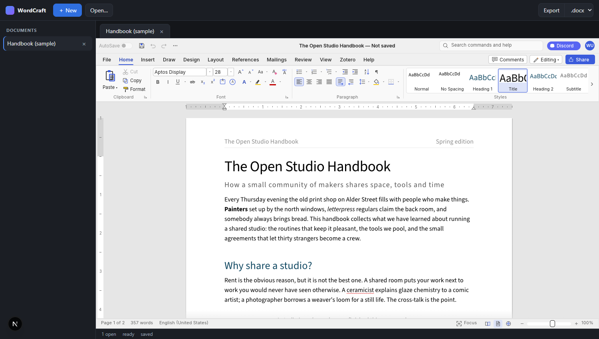
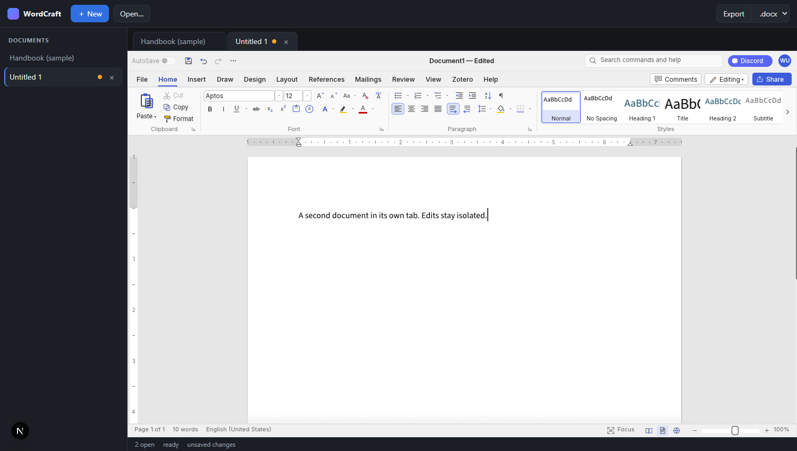
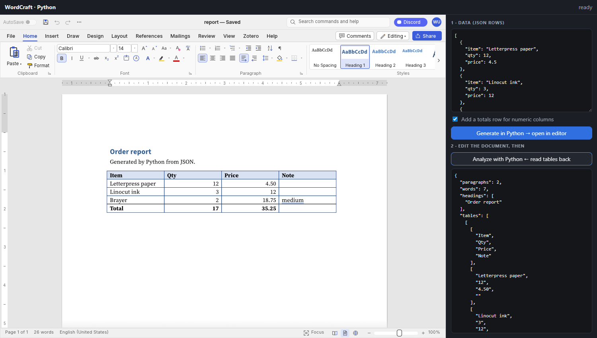
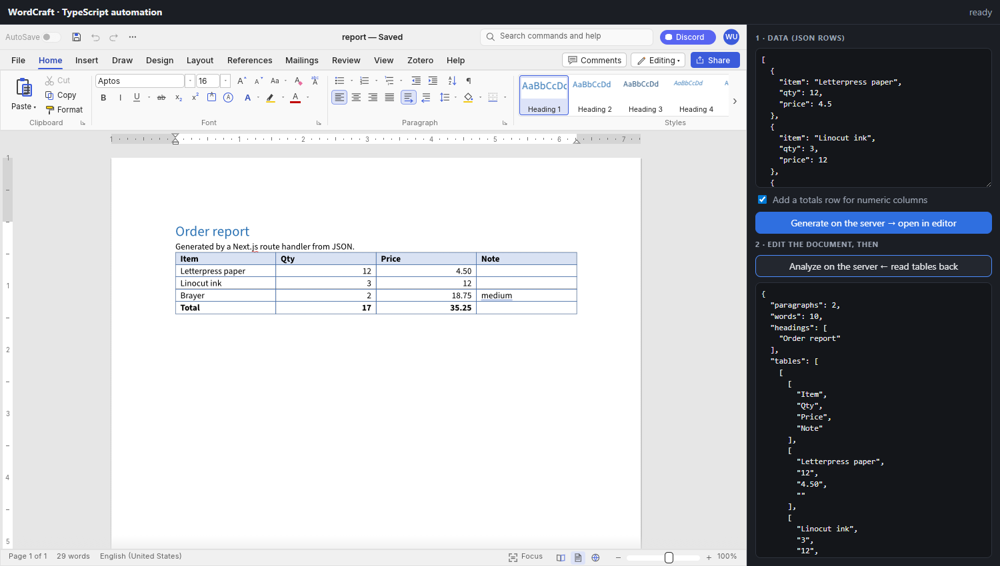

# wordcraft-ts

A full Word-style editor you can drop into any website, from TypeScript.

[WordCraft](https://github.com/storytold/wordcraft) is an open-source word processor written in Rust. This
package compiles it to WebAssembly and wraps it in a small typed API: open `.docx`, edit with the ribbon,
styles, tables and track changes, then export `.docx`, `.odt`, `.rtf`, `.html`, `.md` or `.txt`. Nothing is
sent to a server.



## Use it

```ts
import { mountEditor } from "wordcraft-ts";

const editor = await mountEditor(document.querySelector("canvas")!, { sample: false });

await editor.load(file);                  // File | Blob | Uint8Array (docx, odt, rtf, md, txt, html)
const blob = await editor.exportBlob();   // .docx; or "odt" | "rtf" | "html" | "md" | "txt"
const off = editor.onDirty((dirty) => console.log("unsaved changes:", dirty));

editor.destroy();                         // stop the editor and free its canvas
```

| API | What it does |
|---|---|
| `mountEditor(canvas, opts?)` | Starts an editor on a `<canvas>`. Options: `sample` (open the demo document), `webgl` (force WebGL2), `wasmUrl` (where to load the `.wasm` from). |
| `editor.load(file, name?)` | Opens a document. The format comes from the file name's extension. |
| `editor.export(format?)` / `exportBlob(format?)` | Returns the document as bytes / a `Blob`. Default `docx`. |
| `editor.onDirty(cb)` | Called when the unsaved-changes flag flips. Returns an unsubscribe function. |
| `editor.destroy()` | Stops this editor. Unsaved changes are lost. |

Any number of editors can share a page, one per canvas. Give each canvas a size with CSS; it resizes itself.

## Examples

Every example is a small page with Open, an export-format picker, Export and an unsaved-changes indicator.

| Framework | Folder | Run |
|---|---|---|
| Next.js (multi-document workspace) | [`examples/nextjs`](examples/nextjs) | `bun run dev` |
| React + Vite | [`examples/react`](examples/react) | `bun run dev` |
| Vue 3 + Vite | [`examples/vue`](examples/vue) | `bun run dev` |
| Svelte 5 + Vite | [`examples/svelte`](examples/svelte) | `bun run dev` |
| Astro (plain script, no UI framework) | [`examples/astro`](examples/astro) | `bun run dev` |
| Python backend (generate and read tables) | [`examples/automation/python`](examples/automation/python) | see below |
| TypeScript backend: Next.js route handlers (same flow) | [`examples/automation/nextjs-ts`](examples/automation/nextjs-ts) | `bun run dev` |

One-time setup from the repo root (builds the package, then links it so the examples can import it):

```sh
bun install
bun run build     # Rust -> wasm -> dist (see "Build from source")
bun link
```

Then, for any example:

```sh
cd examples/react      # or vue, svelte, astro, nextjs
bun install
bun run dev
```

On Vite and Astro, add `optimizeDeps: { exclude: ["wordcraft-ts"] }` to the config (every example does), so the
`.wasm` URL inside the package keeps resolving.

### Next.js: multiple documents

[`examples/nextjs`](examples/nextjs) is a multi-document workspace: a sidebar and tab bar, one editor per
document, New / Open / Export, and unsaved-change markers.



The pattern that matters, from [`DocPane.tsx`](examples/nextjs/app/DocPane.tsx):

```tsx
"use client";

useEffect(() => {
  let cancelled = false;
  let ed: WordCraftEditor | undefined;
  mountEditor(canvas.current!).then((e) => {
    if (cancelled) return e.destroy();   // unmounted (or StrictMode re-ran) while loading
    ed = e;
  });
  return () => { cancelled = true; ed?.destroy(); };
}, []);
```

- The editor needs the browser (canvas and WASM), so load it with `dynamic(() => import("./Workspace"), { ssr: false })`
  from a client component.
- Keep background tabs mounted and hide them with `visibility: hidden` (not `display: none`), so each editor keeps
  its size and state.
- Add `transpilePackages: ["wordcraft-ts"]` to `next.config.mjs`.

### Python: generate documents, read them back

[`examples/automation/python`](examples/automation/python) pairs the editor with a small Python server (stdlib + `python-docx`):

1. Paste JSON rows. Python builds a `.docx` whose table columns come from the data, with right-aligned numbers and
   an optional totals row. The editor opens it with `editor.load(bytes)`.
2. Edit the document in the browser.
3. "Analyze" sends `editor.export("docx")` back to Python, which returns every table, the headings and a word
   count as JSON.



```sh
cd examples/automation/python
bun install
python -m venv .venv && .venv/Scripts/pip install -r requirements.txt   # Linux/macOS: .venv/bin/pip
python test_server.py             # self-check
bun run server                    # terminal 1: Python API on :8000 (Linux/macOS: .venv/bin/python server.py)
bun run dev                       # terminal 2: the page, proxying /api to Python
```

The server binds to `127.0.0.1` and has no authentication; it is a demo, not something to expose.

The same flow in TypeScript lives in [`examples/automation/nextjs-ts`](examples/automation/nextjs-ts). Next.js
route handlers (`app/api/generate`, `app/api/analyze`) build the document with the `docx` package and read tables back
with `fflate` and `fast-xml-parser`, so one `bun run dev` is all it needs. `bun run test` runs its self-check.



## Things to know

- **Canvas-rendered.** The editor draws itself like a game, so it is not a DOM text box: page CSS doesn't style it,
  and text inside it isn't selectable like web text. Test mobile keyboards and IME early.
- **Size.** The `.wasm` is about 30 MB (about 12 MB gzipped). Serve it as `application/wasm` with gzip or brotli,
  and cache it.
- **Browser support.** Needs WebGPU or WebGL2. `webgl: true` forces WebGL2.
- **Browser only.** Don't call `mountEditor` during server rendering.

## Build from source

You need Rust, the upstream repo cloned next to this one (`../wordcraft-src`, or set `WORDCRAFT_SRC`), and:

```sh
rustup target add wasm32-unknown-unknown
cargo install wasm-bindgen-cli --version 0.2.129 --locked   # must match upstream's Cargo.lock
git clone https://github.com/storytold/wordcraft ../wordcraft-src
```

```sh
bun install
bun run build                    # Rust -> wasm -> src/wasm -> dist (the wasm-opt step takes ~5 min)
SKIP_OPT=1 bun run build:wasm    # faster dev build, bigger .wasm
```

The only Rust added here is [`rust/wordcraft-embed`](rust/wordcraft-embed), a thin wasm-bindgen layer
(`mount`, `unmount`, `loadFile`, `exportDocument`, `onDirty`). It reuses upstream's editor unchanged, and the
build script copies it into the upstream workspace.

## License

Same as WordCraft: MIT OR Apache-2.0.
